# seqTubeMaps — MemPanG26 Edition

Fork of [vgteam/sequenceTubeMap](https://github.com/vgteam/sequenceTubeMap):
pangenome graphs and reads drawn as tube maps, in the browser. Adds in-browser
reading of [gfa-to-tabix](https://github.com/GMOD/gfa-to-tabix) walk files,
uploads, and a modernized React/TypeScript UI.

Live demo: https://cmdcolin.github.io/sequenceTubeMap/

MemPanG26 Hackathon Team 2 — [Colin Diesh](https://github.com/cmdcolin) &
[Rafeed Rahman Turjya](https://scholar.google.com/citations?user=Vb6tJA0AAAAJ&hl=en)
et al.

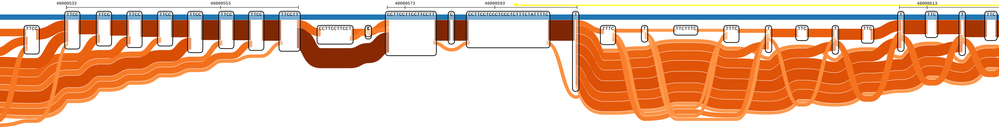

464 HPRC v2.1 haplotypes at a chr20 CT microsatellite — 46 allele lengths, 240
distinct routes. Read straight from HPRC's 10 GB hosted `.gbz.db` by range
request: no server, no download. Coarsened (Sankey) view bands the haplotypes by
node-to-node edge instead of drawing all 464 as separate lines, darker the more
haplotypes take that edge; haplotypes named from the companion index
(`HG01243#2#…`, not `unknown#57`).

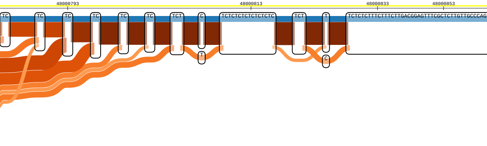

Same locus, view scrolled ~260 bp right: haplotypes back in register. Both
figures are crops of one drawing the app lays out end to end and lets you
scroll.

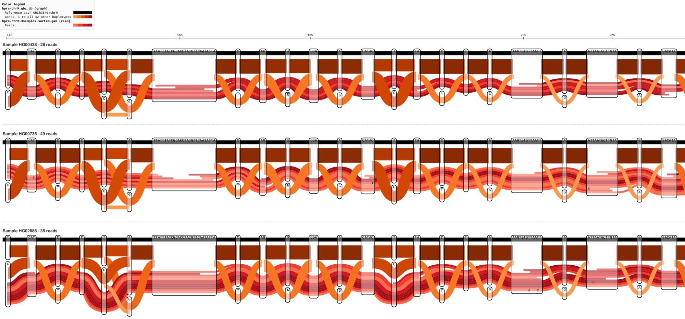

Facets: the View menu's "Facet by" splits one graph into a labelled panel per
read sample or read group, or per haplotype sample from the haplotypes' PanSN
names. Every panel shares node positions, so a branch one sample's reads take
and the others skip lines up down the stack. Here HG02886's reads leave the
reference for the C alleles at chrM 146 and 152 while HG00438's and HG00735's
stay on T, over the HPRC chrM graph with the other 42 haplotypes banded. The
reads are simulated from the three samples' haplotypes, since no bundled
alignment file carries more than one sample. See
[headless rendering](docs/headless-rendering.md) for the CLI flags and more
figures.

## What a tube map shows

A sequence graph encodes related sequences — individuals of one species, or
homologs across species — as shared and diverging paths through nodes.

- **Node** — a stretch of bases; length sets its drawn width.
- **Path** — one sequence, walking through nodes.

Two paths, same three nodes, same sequence:

Where sequences differ, paths part around a bubble:

An inversion: one node traversed both directions, not two nodes:

Graphviz and d3 force layouts draw nodes and edges with no notion of a path or
of orientation. The tube map draws paths as lines on a transit map, with d3. The
layout comes from [@jbrowse/tubemap-core](https://github.com/GMOD/tubemap-core),
a separate package with no DOM or d3, so other apps can draw it their own way.

## Loading data

Use **File → Open…**, or pick a dataset from the **Examples** menu.

|                             | Where the work happens  | Size limit    | Setup needed               |
| --------------------------- | ----------------------- | ------------- | -------------------------- |
| **vgteam server** (default) | `api.tubemap.graphs.vg` | 5 MB per file | none                       |
| **In-browser**              | your browser            | none          | walk-file conversion       |
| **Self-hosted server**      | your machine            | none          | Docker or a local checkout |

Servers take `.xg`, `.vg` and `.gbz` graphs and `.gam` reads directly.
In-browser mode needs a `gfa-to-tabix --walks` file; it reads a hosted one by
range request, so a whole-pangenome graph browses with no download. It still
opens a legacy `.gbz.db`. Details: [docs/data.md](docs/data.md).

## Reads over a graph

GAM alignments over the snp1kg BRCA1 graph. Blue: every node visit is
reverse-strand. Mixed-orientation reads draw forward, in red:

[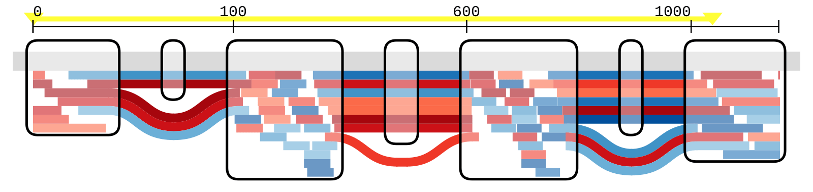][demo-reads]

Link carries compressed node widths plus region. Browser subsamples to 100 reads
to stay responsive (banner above the map raises the cap).

Coarsened (Sankey) view: one band per node-to-node edge, scaled by read count —
O(edges), not O(reads). Allele balance at a bubble reads at a glance. The same
view works on a haplotype-only graph with no reads loaded, as in the chr20
figures above: it bands the haplotypes by edge instead.

[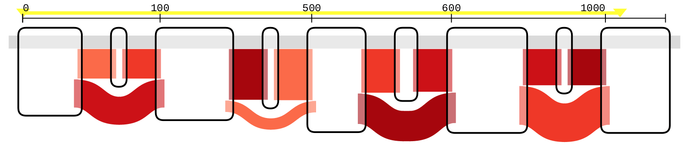][demo-coarsened]

## Folding small variants

A 51 kb window of HPRC v2.1, `GRCh38#chr1:72298000-72349000`, is 1,906 nodes.
Banded and with logarithmic node widths, which is how the app offers to draw a
window this size, it is 113,712 px wide. The strip is that whole drawing
squeezed to the page, and under it is its first 2,000 px:

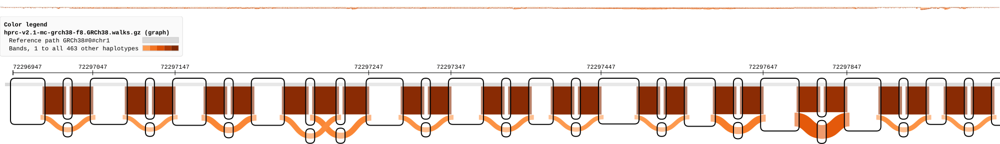

The View menu's **Fold variants under** merges every variant shorter than the
threshold into the reference, with `@jbrowse/graph-fold`, and labels what is
left. At 1 kb the same window is 9 nodes and 6 tubes: a 45.5 kb deletion on 306
of the 464 haplotypes, and an insertion of 8.9 to 9.5 kb on 129.

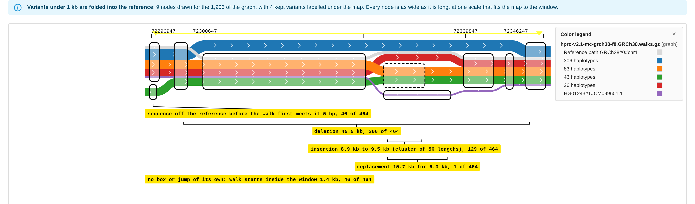

- A bracket under the map spans each kept variant, over its kind, its size and
  how many haplotypes carry it. Insertions of nearly one size at one site are
  one dashed box, labelled with their range and how many lengths it stands for:
  `insertion 8.9 kb to 9.5 kb (56 lengths), 129 of 464`.
- Each tube is one route through the folded graph, wider the more haplotypes
  take it, on a log scale. Its haplotypes share the route and its orientations
  and differ under the threshold: the blue tube is 306 haplotypes on 127
  distinct walks, with 72 to 90 bp folded away in each. The legend names a tube
  by its haplotype count, and hovering or clicking it says the rest and names
  its walks.
- A merged node is as wide as it is long, at one scale that fits the map to the
  window, so the 39 kb the deletion leaves out is the widest box. Clicking a
  node says how many nodes it holds and where it lies on the reference.
- Chevrons on a tube point the way it runs.

`GRCh38#chr16:75204000-75225000` unfolded is 1,655 nodes and 85,596 px. Folded
at 1 kb it is three nodes, and the 439 haplotypes that carry a 16.6 kb inversion
make the loop: the orange tube passes under the block, turns, runs back through
it against the reference, its chevrons pointing left, turns again and carries
on. The block is five times as wide as its 3.2 kb flanks, as it is long.

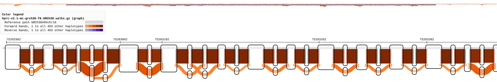

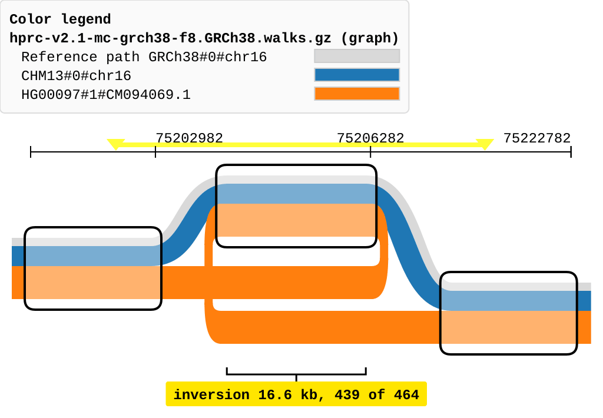

The control is off by default, and a link carries it as `fold=1000`:

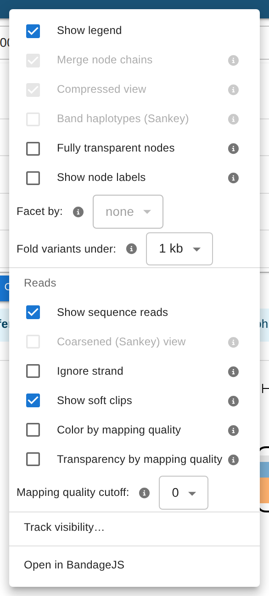

What it does not do:

- **Reads are hidden while folded.** A read maps to the nodes the fold merged
  away and has no place on the merged ones, so the notice above the map counts
  the reads it left out.
- **A graph whose reference passes a node more than once is not folded**, as in
  a pggb graph with a collapsed repeat: a run off the reference there may be a
  copy of reference sequence and not a variant. The graph is drawn as it is and
  a notice gives the reason.
- **A haplotype lying wholly inside an inversion** takes every step reversed, as
  does one written against the reference. The fold cannot tell them apart,
  reports no inversion for either and draws both reversed.
- **Nothing is nested.** A variant inside a kept insertion makes it another size
  of that insertion.
- Banding and faceting are off while folded.

`pnpm tubemap-cli --fold-variants 1000` draws the same figure headlessly. More
in [docs/fold-variants.md](docs/fold-variants.md).

## Navigating and sharing

Region box takes `<contig>:<start>-<end>` (`Circ1:0-1320`), `chr1:1000+500`, or
`node:42-55`. **Paths in this graph** browses a graph's contigs. The URL carries
data, region and view options — any tube map is a shareable link
([params](docs/urlparams.md)).

**View → Open in BandageJS** opens the same window of a hosted walk file or
`.gbz.db` in [BandageJS](https://jbrowse.org/demos/bandagejs/), a force-directed
graph viewer.

[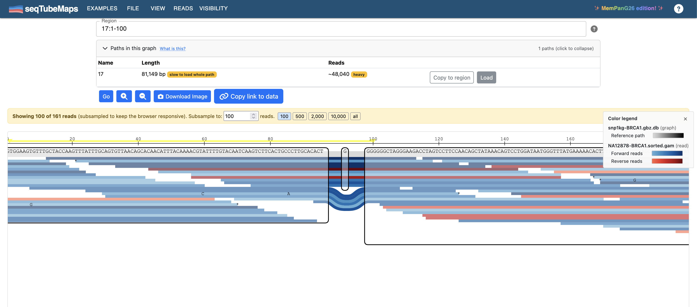][demo-brca1]

## Headless rendering

`pnpm tubemap-cli` renders your own walk file or `.gbz.db` and reads, or any
link or bundled source, to SVG, no browser — made every figure here but the app
screenshot. [Details](docs/headless-rendering.md), and a
[gallery](docs/headless-rendering.md#gallery) of banded haplotypes and read
encodings.

## Docs

- [docs/data.md](docs/data.md) — guide for loading your own data
- [docs/server.md](docs/server.md) — running the server in Docker or from a
  checkout
- [docs/urlparams.md](docs/urlparams.md) — every parameter a link can carry
- [docs/headless-rendering.md](docs/headless-rendering.md) — `pnpm tubemap-cli`
  and its options
- [docs/fold-variants.md](docs/fold-variants.md) — folding small variants so the
  structural ones are left, and what a folded map does not show
- [docs/differences-from-upstream.md](docs/differences-from-upstream.md) — what
  changed from vgteam/sequenceTubeMap

## Thanks

Big thanks to the [MemPanG26](https://pangenome.github.io/MemPanG26/) organizers
and group, and to the original sequenceTubeMap developers!

_Claude Code AI was used during this work._

[demo-brca1]:
  https://cmdcolin.github.io/sequenceTubeMap/?name=snp1kg-BRCA1%20(gfa-to-tabix%20walks)&region=17:1-100
[demo-chr20]:
  https://cmdcolin.github.io/sequenceTubeMap/?name=HPRC%20v2.1%20whole%20genome%20(gbz-base%2C%20URL-hosted)&region=GRCh38%23chr20:48000600-48001000&vis=coarsenedReadView
[demo-reads]:
  https://cmdcolin.github.io/sequenceTubeMap/?name=snp1kg-BRCA1%20(gfa-to-tabix%20walks)&region=17:1-1000&vis=compressedView
[demo-coarsened]:
  https://cmdcolin.github.io/sequenceTubeMap/?name=snp1kg-BRCA1%20(gfa-to-tabix%20walks)&region=17:1-1000&vis=compressedView,coarsenedReadView
