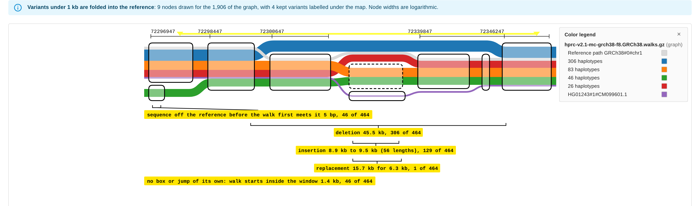

# Folding small variants

A window of a pangenome graph is mostly SNPs and short indels: 51 kb of HPRC
v2.1 is 1,906 nodes, and the structural variants in it are a handful. The View
menu's **Fold variants under** merges every variant shorter than a threshold
into the reference, so those few are what the map draws. The fold is
`@jbrowse/graph-fold`'s, which reads node lengths and walks and never a base.

## Turning it on

- **In the app:** View → **Fold variants under** → 50 bp, 1 kb or 10 kb. It is
  off by default and remembered with the other View settings.
- **In a link:** `fold=1000` ([urlparams.md](urlparams.md#fold)).
- **Headless:** `pnpm tubemap-cli --fold-variants 1000`, which takes any
  threshold in bp ([headless-rendering.md](headless-rendering.md#view-options)).

The threshold is a view setting, so changing it folds the graph already loaded
and fetches nothing.

## What is drawn

- **The reference is the backbone**, cut at every breakpoint a kept variant
  uses. Each piece between two cuts is one merged node.
- **A kept variant** is a detour whose own length, or the reference it replaces,
  reaches the threshold: an insertion is a box off the backbone, a deletion a
  tube that jumps between two backbone nodes, and an inversion a backbone node
  the tube enters from its far end and runs back through.
- **A bracket under the map** spans each kept variant, over a label:
  `deletion 45.5 kb, 306 of 464`. The count is of haplotypes, out of every walk
  in the window, the reference among them. A replacement gives both sizes,
  `replacement 15.7 kb for 6.3 kb`.
- **A cluster** is insertions or deletions at one site whose breakpoints and
  lengths differ by at most 5% of the larger. It is drawn once, at its most
  carried size, in a dashed box, and its label gives the range and the number of
  lengths in place of one size:
  `insertion 8.9 kb to 9.5 kb (56 lengths), 129 of 464`. Clustering is always on
  while folded; without it that one site is 56 boxes in a column.
- **A variant with no box or jump of its own**, such as walks that start inside
  the window, is listed in a line at the foot of the map and not left out.
- **One tube per route**, never bands. A band is drawn per edge and nothing
  inside a node, which hides the pass an inversion makes back through its block.
  A tube's width grows with the logarithm of its haplotype count, as the app
  draws any walk that stands for several, so one haplotype stays visible beside
  four hundred.
- **Node widths are logarithmic**, as under Compressed view. A merged node is
  tens of kb, which at one character per base is hundreds of thousands of px.
  Widths therefore do not compare as sizes, and the labels carry the sizes.

## What a tube and a node stand for

A folded tube is every haplotype that takes its route, and they are not
identical. On `GRCh38#chr16:75204000-75225000` at 1 kb the looping tube is 439
haplotypes on 356 distinct walks, each with between 8 and 795 bp folded away; 26
of them carry a 584 bp deletion that only separates at a 50 bp threshold. The
route and the orientation of every step are exact for all of them, and what
differs is under the threshold.

- **The legend and the track list** name a tube by its count, `439 haplotypes`,
  and not by the first of them. A tube of one haplotype keeps that walk's name.
- **Hovering a tube** says
  `439 haplotypes on 356 distinct walks, 8 bp to 795 bp folded away in each`,
  and then names its walks, the first five of many. Clicking it lists the same
  in the info dialog.
- **Clicking a node** adds to the info dialog how many nodes of the unfolded
  graph it holds, its span on the reference and the variant it is the box of.

## Limits

- **Reads are hidden.** A read maps to the nodes the fold merged away, and the
  layout stops on a read that visits a node it was not given. The notice above
  the map counts the reads left out, and the CLI says so on stderr.
- **Some graphs are not folded.** A run off the reference is a variant only when
  the reference passes each node once. Where it does not, as in a pggb graph
  with a collapsed repeat, the run may be a copy of reference sequence. The
  graph is then drawn as it is, with its reads, under a notice that gives the
  reason. A walk file states how many nodes its reference revisits in the whole
  graph, and the fold goes by that as well as by the window.
- **A haplotype lying wholly inside an inversion** takes every step reversed, as
  does a haplotype written against the reference. The fold cannot tell them
  apart, reports no inversion for either and draws both reversed.
- **Nothing is nested.** A variant inside a kept insertion changes that
  insertion's length and makes it another size of it.
- **Close breakpoints leave short backbone nodes**: the chr1 window keeps a 1 bp
  node between two variants that end one bp apart.
- **The first track is the reference.** That is the reference path of a walk
  file or `.gbz.db`; a vg server's graph is folded against whichever path it
  lists first.
- **No direction marks yet.** Nothing on a tube says which way it runs, so an
  inversion reads from the shape of the loop alone. The chevrons are written:
  they are drawn on every run the layout marks `reverse`, which
  `@jbrowse/tubemap-core` does from the release after 2.1.1.
- **A tube is one color along its length.** It is not paler where it passes a
  node without reading it, as `@jbrowse/graph-fold`'s own pictures draw it: the
  app shades a tube inside every node box alike.
- **Faceting is off while folded**, since a folded tube is many samples'
  haplotypes, and so are **Merge node chains** and the node colors a BED file
  sets, which name unfolded nodes.
- **The node info dialog's Haplotypes row counts tubes**, as it counts distinct
  walks in an unfolded graph.

## Regenerating the figures

`scripts/make-fold-figures.sh` draws both README windows unfolded and folded
with `pnpm tubemap-cli`, and `node scripts/screenshot-ui.mjs fold-variants`
takes the app screenshots
([DEVELOPING.md](../DEVELOPING.md#figures-in-the-docs)).
